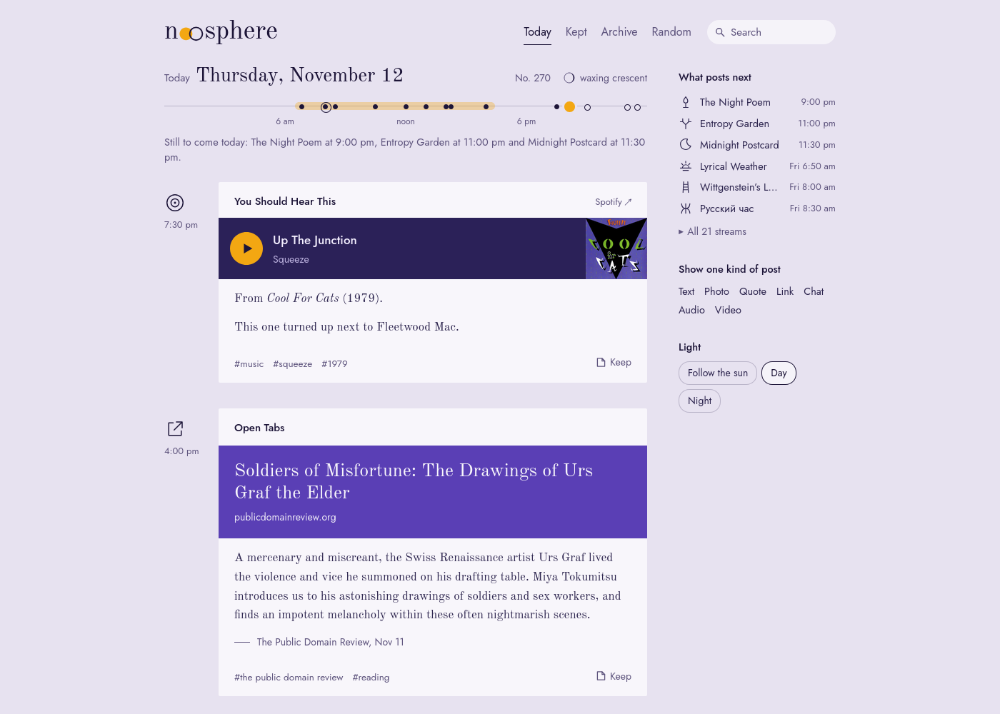

# Noosphere

A personal content feed — your own private social media timeline, populated by automated content generators that match your interests. No algorithms optimizing for engagement, no ads, no other people's opinions. Just a daily stream of things worth reading.

Named after [Vernadsky's concept](https://en.wikipedia.org/wiki/Noosphere) of the sphere of human thought.



## What It Is

Noosphere is a self-hosted feed laid out as an almanac with one reader. It borrows its bones from a 2013 Tumblr dashboard (one column, seven kinds of post, tags) and adds what a feed with no people in it can have: because every stream posts at a fixed hour, the page knows the shape of a day in advance. Each stream is a Python script that posts one card a day (or a week) on its own schedule. Cards accumulate, and the site keeps the last 500.

Every stream quotes a real source. The local language model has two small jobs left: it translates the Russian and corpus sentences into English (labelled as machine translation), and it proposes artist names for the music stream, which are then checked against Spotify. A card is written whether or not the model is running.

## The 21 Streams

| Blog | Post type | Cadence | Source |
|------|-----------|---------|--------|
| **lyrical-weather** | text | Daily | National Weather Service forecast and the Boston/Norton office's key messages |
| **wittgensteins-ladder** | quote | Daily | The Tractatus in order, each proposition with the rungs above it |
| **russkiy-chas** | quote | Daily | 164 curated Russian literary sentences, fixed-table transliteration, machine translation |
| **corpus-surprise** | quote | Daily | A random sentence from the Leipzig corpora (13 languages), machine translation |
| **a-language-a-day** | text | Daily | A typological profile from WALS (749 languages, CC BY 4.0) |
| **open-tabs** | link | Daily | The newest unseen item from a short list of RSS feeds |
| **git-log-oneline** | chat | Daily | Recent commits from 30 watched repositories (GitHub API) |
| **midday-museum** | photo | Daily | A public-domain painting from the Art Institute of Chicago |
| **midnight-postcard** | photo | Daily | One Unsplash photograph, credited |
| **entropy-garden** | video | Daily | A seeded canvas simulation drawn in the browser |
| **you-should-hear-this** | audio | Daily | A song near an artist already in the library, verified on Spotify |
| **the-untranslatable** | text | Mon, Wed, Fri | 49 curated words with their Wiktionary senses |
| **the-night-poem** | text | Tue, Thu, Sun | A short public-domain poem from PoetryDB |
| **apophenia-machine** | link | Tue, Thu | Two unrelated real items (Wikipedia, arXiv, PoetryDB, On This Day) |
| **the-penny-red** | text | Tue, Sat | 46 renamed places with the name section of their Wikipedia article |
| **the-diff** | chat | Monday | One passage in two to four languages, from a curated list of 20 |
| **typeface-of-the-week** | photo | Wednesday | A typeface from Wikipedia with its specimen image |
| **the-recipe-box** | photo | Wednesday | A recipe from TheMealDB as published, plus one ingredient's Wiktionary etymology |
| **the-dead-medium** | text | Friday | 61 defunct media with the lead of their Wikipedia article |
| **commonplace-book** | text | Sunday | A paragraph from one of 20 Project Gutenberg novels |
| **monthly-mixtape** | audio | 1st of the month | Last month's daily songs as one tracklist |

A daily **echo** also reblogs one older card so the top of the feed never goes stale.

## Data Sources

- **National Weather Service** (api.weather.gov) for the forecast and forecast discussion
- **WALS Online** (Dryer & Haspelmath 2013, CC BY 4.0), prebuilt into `generators/data/wals.json` by `generators/build_wals.py`
- **Wikipedia and Wiktionary** for article leads, name sections, definitions and etymologies
- **Leipzig Corpora Collection**, **Project Gutenberg**, **PoetryDB**, **TheMealDB**, **Art Institute of Chicago**, **Unsplash**, **GitHub**, **Spotify**, **arXiv**

Requests use a generic client name and carry no personal details.

When a Wikipedia or Wiktionary request fails, the stream writes nothing and leaves its state alone, so the next scheduled run tries the same item again.

For a local llama.cpp server that shouldn't hold the GPU all day, set `LLM_FLEET_ID` to a systemd user unit instance (`llm@<id>`): `ask_claude()` starts it on demand when the endpoint is down and waits for `/health`; an idle timer can stop it again. Set `NOOSPHERE_NO_LLM=1` to skip the model entirely.

## Discord Cross-Posting

Noosphere can automatically cross-post feed items to a Discord channel. When a generator writes a new card, `utils.py` formats it for Discord (with type-specific emoji labels and markdown) and posts via the Discord Bot API.

To enable:
1. Set `NOOSPHERE_DISCORD_CHANNEL` in your `.env` to your target channel ID
2. Configure a Discord bot token via the `DISCORD_BOT_TOKEN` env var

If no Discord credentials are found, cross-posting is silently skipped — feed generation is never blocked.

## Architecture

```
┌─────────────────────────────────────┐
│         noosphere (Express)          │
│         serves /api/feed             │
│         reads JSON from feed/        │
├─────────────────────────────────────┤
│        public/index.html             │
│        PWA frontend                  │
│        7 post types, 21 streams      │
│        almanac theme, day and night  │
│        service worker + offline      │
├─────────────────────────────────────┤
│        generators/                   │
│        22 Python scripts             │
│        run daily via cron            │
│        each writes one JSON to feed/ │
│        schedule.py controls cadence  │
└─────────────────────────────────────┘
```

Each generator is **idempotent** — it checks if today's card already exists before generating. Safe to re-run.

Each generator that uses curated content has **state tracking** — sequential index or used-set with automatic reset when exhausted.

## Setup

### Prerequisites

- Node.js 18+
- Python 3.8+
- An OpenAI-compatible API endpoint (for LLM commentary)
- Optional: Unsplash API key (for Midnight Postcard)

### Installation

```bash
git clone https://github.com/brezgis/noosphere.git
cd noosphere
npm install

# Python dependencies for the generators
# (spotipy is only needed for the two music streams)
pip install requests python-dotenv spotipy

# Configure your LLM endpoint
cp .env.example .env
# Edit .env with your API details

# Create feed directory
mkdir -p feed

# Generate today's content
cd generators && bash run_all.sh

# Start the server
node server.js
# → http://localhost:7701
```

### Configuration

Create a `.env` file:

```bash
# LLM API (any OpenAI-compatible endpoint)
LLM_API_URL=http://localhost:8080/v1/chat/completions
LLM_API_KEY=your-api-key
LLM_MODEL=claude-sonnet-4-20250514

# Optional: Unsplash API (for Midnight Postcard)
UNSPLASH_ACCESS_KEY=your-key

# Optional: Spotify API (for Music Rec + Monthly Playlist)
SPOTIFY_CLIENT_ID=your-client-id
SPOTIFY_CLIENT_SECRET=your-client-secret
SPOTIFY_REDIRECT_URI=http://localhost:8888/callback

# Optional: Last.fm API (for Music Rec similar-artist discovery)
LASTFM_API_KEY=your-lastfm-key

# Optional: customize which repos git log watches
# Edit generators/git_log.py REPOS list
```

### Adapting to Your Interests

The generators are designed to be swapped, edited, or replaced:

- **Different city?** Edit the location in `weather.py` (it ships pointed at Cambridge, MA).
- **Different music taste?** Edit `data/taste-profile.json` — it seeds the music recommendation prompts.
- **Don't speak Russian?** Replace `russian.py` with sentences from any language in the Leipzig collection. Download corpora from [wortschatz.uni-leipzig.de](https://wortschatz.uni-leipzig.de/en/download).
- **Different reading taste?** Edit `data/literary-passages.json` or run the Gutenberg extraction script on your favorite books.
- **Watch different repos?** Edit the `REPOS` list in `git_log.py`.
- **Different places?** Edit the `PLACES` list in `penny_red.py`.
- **Different typefaces?** Edit the `TYPEFACES` list in `typeface.py`.
- **Don't want a stream?** Comment it out of `run_all.sh` and remove it from `schedule.py`.
- **Want a new stream?** Copy any generator as a template. The pattern is: pick data → call LLM for commentary → write JSON to `feed/`.

### Running as a Service

```bash
# systemd user service
cat > ~/.config/systemd/user/noosphere.service << EOF
[Unit]
Description=Noosphere Feed Server
After=network.target

[Service]
Type=simple
WorkingDirectory=/path/to/noosphere
ExecStart=/usr/bin/node server.js
Restart=always
RestartSec=5

[Install]
WantedBy=default.target
EOF

systemctl --user daemon-reload
systemctl --user enable --now noosphere
```

### Daily Generation

Set up a cron job or scheduled task to run generators daily:

```bash
# crontab -e
0 6 * * * cd /path/to/noosphere/generators && bash run_all.sh >> /var/log/noosphere-gen.log 2>&1
```

## Frontend

Vanilla JS with no framework and no build step: `public/index.html`, `style.css`, `app.js` and `garden.js`.

- The page is one column of posts with a margin beside it. Each stream has a line-drawn mark of its own, shown in the margin with the time of the post.
- Every day has a heading with its date, its number (day 1 is the first card, 16 February 2026), the phase of the moon, and a line from midnight to midnight with a dot at the minute of each post. The band on the line is the daylight from that day's weather card.
- Today's line also shows the posts still to come as hollow dots, the present moment as a yellow dot, and a list of what is on the way. The sidebar lists every stream by when it posts next. These times come from the `at` and `days` fields of the `STREAMS` table in `app.js`, which repeat `generators/schedule.py` and each generator's timestamp, so a schedule change has to be made in both places.
- Each stream maps to one of seven kinds of post (text, photo, quote, link, chat, audio, video). The sidebar can filter the feed to one kind.
- Echo cards render as returning posts, with a dashed outline in place of a solid card. "Keep" under a post turns its corner down and adds it to the Kept view, which is stored in the browser's local storage.
- Tags come from each card's own metadata and filter the feed when clicked. There is also search, an archive grid, a random-post link and permalinks (`#/post/<id>`).
- The keys J and K move between posts, L keeps one, and / opens search.
- There is a day palette and a night palette. By default the page follows the sun and switches at the sunrise and sunset in the newest weather card; the sidebar can pin either one.
- Cards written before the v2 streams still render. Their model-written commentary is shown in smaller grey type.

To preview locally without uploading anything:

```bash
INCLUDE_SCHEDULED=1 bash build.sh .preview   # builds the static site, including cards scheduled for later today
python3 -m http.server 8951 --directory .preview
```

## Content Pool Sizes

| Pool | Items | Runway |
|------|-------|--------|
| Tractatus propositions | 513 | ~1.4 years daily |
| Russian sentences | 164 | ~5.5 months daily |
| Literary passages | 566 | ~11 years weekly |
| Corpus sentences | 130,000 | Effectively infinite |
| Untranslatable words | 50 | ~17 weeks at 3x/wk |
| Places (Penny Red) | 46 | ~23 weeks at 2x/wk |
| Dead media | 61 | ~61 weeks weekly |
| Parallel translations | 20 | ~20 weeks weekly |
| Typefaces | hundreds (live from Wikipedia) | Effectively infinite |
| Seasonal ingredients | 36 | ~9 months weekly |

A low-stock monitor in `run_all.sh` alerts when any pool drops below threshold.

## Tests

```bash
pip install -r requirements-test.txt
make test        # Python unit tests (pytest)
make test-full   # unit tests + Playwright e2e smoke test
```

The e2e test needs a browser: `npx playwright install chromium`. CI runs both suites on every push (`.github/workflows/test.yml`).

## Deployment (Production)

Noosphere is deployed as a **static site** — no Express server exposed to the internet.

### How it works

```
local server                           VPS
┌──────────────────────┐               ┌──────────────────────────┐
│ generators/run_all.sh │               │ nginx                    │
│   ↓                   │    SCP        │   ↓                      │
│ feed/*.json           │ ──────────→   │ /home/projects/noosphere │
│   ↓                   │  every 5 min  │   /public/               │
│ export.sh             │               │     index.html           │
│   builds static JSON  │               │     api/feed (static)    │
│   copies frontend     │               │                          │
└──────────────────────┘               └──────────────────────────┘
                                              ↓
                                        https://noosphere.brezgis.com
```

1. **Cron job** runs `export.sh` every 5 minutes
2. `export.sh` runs the Python generators (idempotent — skip if today's cards exist)
3. `build.sh` builds the static site with a static `/api/feed` JSON file from the feed directory (latest 500 items)
4. Copies the PWA frontend + feed JSON to the VPS via SCP
5. **nginx** serves it as static files over HTTPS (Let's Encrypt)

### Why static?

Running Express on a home server with personal data is a risk — any RCE vulnerability gives an attacker access to everything. Static export means zero attack surface: the public internet never touches the local server. The VPS serves plain files under a dedicated `projects` user with no shell access.

### The `projects` user

A dedicated system user (`projects`) owns all public-facing project files. It's SFTP-only (chrooted, `ForceCommand internal-sftp`), so even if credentials leak, the attacker can only read/write files in the project directory — no shell, no lateral movement.

### DNS

`noosphere.brezgis.com` → A record pointing to the VPS.

TLS via Let's Encrypt with auto-renewal (certbot).

### Export script

```bash
# Manual run:
bash export.sh

# Cron (every 5 minutes):
*/5 * * * * /path/to/noosphere/export.sh >> export.log 2>&1
```

### Previous architecture

Before March 2026, noosphere ran as a live Express server (port 7701, localhost only). The server is preserved in `server.js` for local development but is not used in production.

## License

MIT

## Credits

- [Leipzig Corpora Collection](https://wortschatz.uni-leipzig.de/en/download) for multilingual sentence data
- [Project Gutenberg](https://gutenberg.org) for public domain literature
- [TheMealDB](https://themealdb.com) for recipe data
- [Unsplash](https://unsplash.com) for photographs
- [WALS Online](https://wals.info) for typological data (CC BY 4.0)
- [National Weather Service](https://www.weather.gov) for forecasts
- [Wikipedia](https://en.wikipedia.org) and [Wiktionary](https://en.wiktionary.org) for article text
- [Young Serif](https://fonts.google.com/specimen/Young+Serif) for the wordmark
